  

<!--
  All artwork in assets/ is generated as pure pixel-vector SVG: no web fonts and
  no external images, so it renders identically through GitHub's image proxy.
  Rebuild anytime with:  node tools/generate-assets.mjs
-->